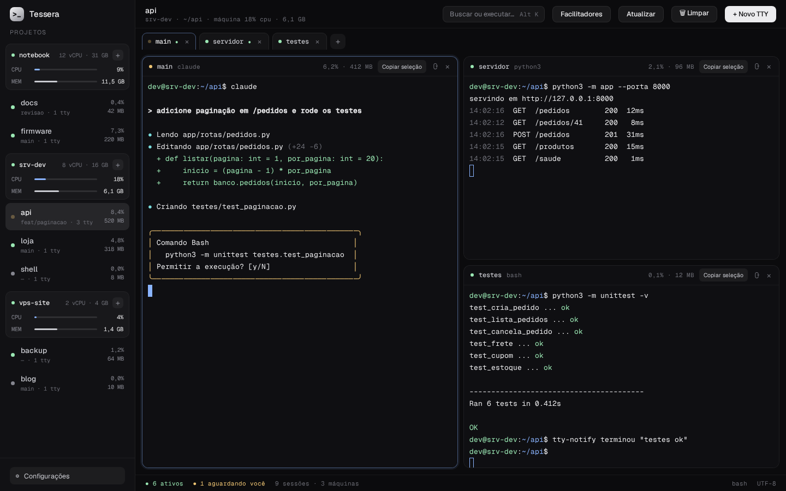
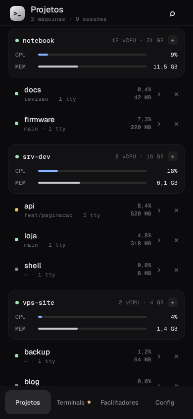
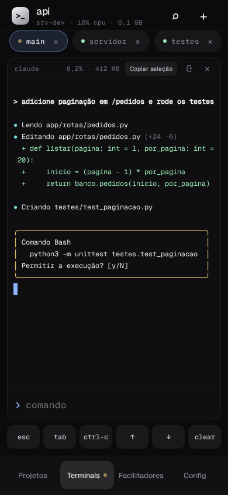

# Tessera

Terminais persistentes em todas as suas máquinas, organizados por projeto, num painel web — e um
celular que **te avisa quando algo precisa de você**.



<p align="center">
  
  &nbsp;&nbsp;
  
</p>

Agentes de IA, builds longos e deploys em várias máquinas significam abas de SSH abertas e checagem
constante. Uma pergunta parada (`[y/N]`, `Password:`) ou um comando que terminou passam
despercebidos por horas. O Tessera mantém os terminais vivos no servidor e vai atrás de você quando
importa.

- **Painel web**: grade de terminais por projeto (até 4 lado a lado), abas estilo VS Code, paleta de
  comandos (`Alt+K`) e cor de estado: verde rodando, âmbar pulsante *aguardando você*.
- **Terminais persistentes**: cada projeto tem seu `ttyd` e suas sessões `tmux`. Feche o navegador,
  o trabalho continua.
- **Todas as máquinas, uma tela**: as máquinas se conectam pela [Tailscale](https://tailscale.com);
  o painel mostra CPU, memória e branch de cada projeto.
- **Máquina nova em um comando**: gere um convite no painel, cole na máquina, ela aparece sozinha.
- **Avisos no Telegram**: com link que abre o painel direto no terminal certo.
- **Facilitadores**: `tty-push` guarda a configuração do Claude Code ou OpenCode no painel;
  `tty-add` aplica em qualquer outra máquina.

Só Python (biblioteca padrão), Bash, tmux, ttyd e xterm.js. Sem build.

> ⚠️ Quem entra no painel executa comandos nos seus terminais, que podem ser de root. Leia
> [Segurança](#segurança) antes de expor uma instalação à internet.

## Quickstart

### Experimentar o painel localmente

Precisa de Python 3. Sobe só o painel, vazio, sem máquinas conectadas:

```bash
git clone https://github.com/IagoMonte/tessera.git
cd tessera
PAINEL_LOCALHOST_LIVRE=1 python3 painel/painel.py
```

Abra <http://127.0.0.1:8787>. Esse modo dispensa senha e é **só para desenvolvimento**.

### Instalar de verdade

**Requisitos**

| onde | o que |
|---|---|
| servidor do painel | Linux com systemd, `/usr/bin/python3`, `openssl`, um domínio apontando para ele, certificado TLS (direto ou via proxy) e Tailscale conectado |
| cada máquina | Linux com `curl` e `python3`; o instalador cuida de tmux, jq, ttyd e Tailscale |
| opcional | chave da API da Tailscale (convites com `sudo`) e um bot do Telegram (avisos) |

**1. Baixe o código no servidor e gere os segredos**

```bash
git clone https://github.com/IagoMonte/tessera.git
cd tessera
python3 painel/painel.py --totp-novo   # segredo do 2º fator; cadastre no app autenticador
openssl rand -base64 24                # senha do painel
openssl rand -hex 32                   # token mestre das máquinas
```

**2. Crie `painel/.env`** e proteja com `chmod 600 painel/.env`. Exemplo atrás de um proxy local:

```ini
PAINEL_DOMINIO=painel.exemplo.com
PAINEL_SENHA=<a senha gerada, 20 caracteres ou mais>
PAINEL_TOTP_SECRET=<o segredo do passo 1>
PAINEL_TOKEN=<o token mestre, 32 caracteres ou mais>

PAINEL_ATRAS_PROXY=1
PAINEL_BIND=127.0.0.1
PAINEL_PORTA=9443
PAINEL_TLS_CERT=/etc/tessera/tls/cert.pem
PAINEL_TLS_KEY=/etc/tessera/tls/key.pem

# opcionais
TS_API_KEY=
TG_TOKEN=
TG_CHAT=
```

O painel só atende HTTPS, mesmo atrás do proxy. Para o trecho local, um certificado autoassinado
basta. O usuário do serviço precisa ler os dois arquivos, e eles não podem ficar em `/home` (o
serviço roda com `ProtectHome=yes`):

```bash
sudo mkdir -p /etc/tessera/tls
sudo openssl req -x509 -newkey rsa:2048 -nodes -days 825 -subj "/CN=127.0.0.1" \
  -keyout /etc/tessera/tls/key.pem -out /etc/tessera/tls/cert.pem
sudo chown "$USER" /etc/tessera/tls/key.pem
```

**3. Instale o serviço**

```bash
sudo painel/instalar-painel.sh          # roda como o usuário do sudo; use --usuario para outro
journalctl -u tty-orquestrador-painel -n 20
```

Se faltar alguma variável obrigatória, o painel não sobe e o log diz qual.

**4. Publique pelo proxy** (exemplo com [Caddy](https://caddyserver.com), que emite o certificado
público sozinho):

```caddyfile
painel.exemplo.com {
	reverse_proxy https://127.0.0.1:9443 {
		header_up Host {host}
		transport http {
			tls_insecure_skip_verify
		}
	}
}
```

Sem proxy: remova `PAINEL_ATRAS_PROXY` e `PAINEL_BIND`, use `PAINEL_PORTA=443` e aponte
`PAINEL_TLS_CERT/KEY` para o certificado do seu domínio.

No firewall, deixe expostas só a porta 443 (e o SSH, restrito).

**5. Conecte uma máquina**

Acesse `https://painel.exemplo.com`, entre com a senha e o código do app, abra
**⚙ Configurações → Máquinas**, dê um nome e clique em **Gerar convite**. Cole o comando na máquina
nova. Ela aparece sozinha no painel.

- Com `sudo`: o convite exige `TS_API_KEY` no `.env`.
- **Sem sudo**: para um usuário comum de uma máquina que já está na sua rede Tailscale. Nesse modo
  não há firewall local; não use em servidor com usuários não confiáveis.
- Desfazer: rode o mesmo comando com `--remover`.

## tty-notify: o terminal que te chama

Qualquer coisa que rode num terminal do Tessera pode te mandar uma mensagem no Telegram, já dizendo
**de onde veio** e com um **link que abre o painel direto naquele terminal**:

```
✅ servidor-1 · api/main
terminou: build do site pronto (212s)
https://painel.exemplo.com/#/servidor-1/api/main
```

```bash
tty-notify terminou "build do site pronto"
tty-notify erro "deploy falhou"
tty-notify --arquivo relatorio.pdf "relatório de hoje"    # até 50 MB, direto no Telegram
```

Motivos: `terminou`, `aprovacao`, `pergunta`, `erro`, `ocioso`, `online`. Cada um liga e desliga em
Configurações › Notificações.

### Você nem precisa chamar

| Fonte | Quando avisa |
|---|---|
| **shell-hook** (bash e zsh) | comando que leva 15 s ou mais, ou termina com erro (`vim`, `ssh`, `less`… são ignorados) |
| **vigia** | tela parada numa pergunta: `[y/N]`, `Approve`, `Continue?`, `Password:`; ou terminal ocioso por 10 min |
| **Claude Code** | hooks `Notification` e `Stop`, instalados pelo `tty-add claude` |
| **OpenCode** | plugin gerado pelo `tty-add opencode` |

Quando o aviso pede você (`aprovacao`, `pergunta`), o terminal fica **âmbar pulsando** no painel até
haver atividade nele.

### Receitas

```bash
make build; tty-notify terminou "build: $?"
./script.sh && tty-notify terminou ok || tty-notify erro "falhou"
tty-notify --arquivo dump.sql.gz "backup do banco"
```

Avisar nunca quebra o script que chama. Sem painel configurado, não faz nada. (`--arquivo` é a
exceção: sai com erro se o arquivo não existir ou o envio falhar.)

## Arquitetura

```
você ──https──▶ painel ◀──https── agente (em cada máquina)
                  │
                  └──relé pela Tailscale──▶ ttyd ──▶ tmux   (um ttyd por projeto)
```

- **Painel**: servidor HTTP em Python que serve a interface, guarda o estado, enfileira tarefas,
  envia os avisos ao Telegram e faz o relé dos terminais.
- **Agente**: em cada máquina, envia métricas e **puxa** tarefas. As tarefas são uma lista fechada,
  validada no painel e de novo no agente, nunca texto livre passado ao shell.
- **Projeto**: uma pasta (e um usuário) numa máquina, com seu próprio `ttyd`.
- **Terminal**: uma sessão `tmux` chamada `projeto/terminal`.

```
painel/          servidor + interface web
agente/          agente por máquina (métricas e tarefas)
projetos/        tty-projeto, tty-sessao, tty-ttyd, tty-supervisor, tty-firewall
bootstrap/       instalação de máquina nova
notificador/     tty-notify, shell-hook, vigia
facilitadores/   tty-add / tty-push
skills/          skill para agentes de IA usarem os comandos tty-*
testes/          integração; ./test.sh roda tudo
```

## Segurança

- Entrada humana única: `https://<seu domínio>`. Acesso por IP, `localhost` ou outro nome é
  recusado, e a rede Tailscale nunca acessa o painel.
- Login com senha (20+ caracteres) e código TOTP. Sessão de 30 min renovada pelo uso, com teto de
  8 h. Falhas repetidas bloqueiam o IP.
- O terminal no navegador passa pelo relé autenticado do painel. Cada `ttyd` escuta na Tailscale,
  exige uma credencial própria e, em instalação com root, só aceita o IP do painel.
- Um token por máquina, que só age em nome dela nas rotas de agente. Ele também lê as configurações
  de ferramentas enviadas com `tty-push`, compartilhadas entre todas as máquinas.
- `/bootstrap.sh` é aberto de propósito (instalador sem segredos); o convite confere o hash dele
  antes de executar.

O modelo completo e os **riscos residuais aceitos** estão em [docs/SEGURANCA.md](docs/SEGURANCA.md).

## Atualizar e testar

```bash
git pull && ./test.sh
sudo painel/instalar-painel.sh          # no servidor; preserva .env e dados/
```

Depois clique em **Atualizar** no painel para levar os scripts novos às máquinas.

## Documentação

- 📘 [Guia de uso](docs/USO.md): o que cada coisa faz e como usar
- 🔧 [Documentação técnica](docs/IA.md): referência completa
- 🔒 [Segurança](docs/SEGURANCA.md): login com 2FA, sessões e configuração de produção

## Licença

[MIT](LICENSE). O xterm.js incluído em `painel/static/vendor/` tem a
[própria licença](painel/static/vendor/LICENSE), também MIT.
